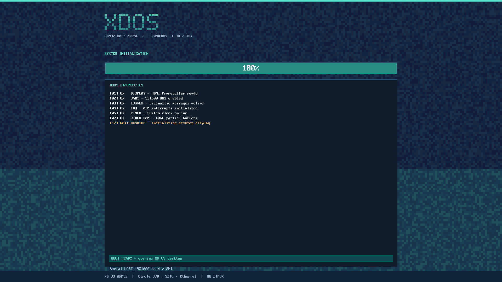
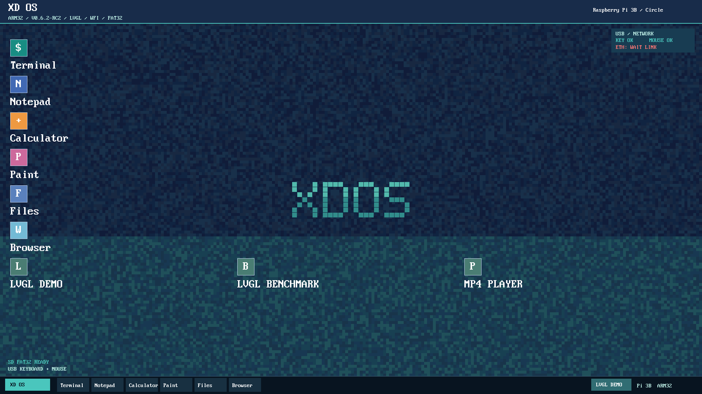

# Raspberry Pi XDOS

[繁體中文](README_ZH.md) · [Latest prerelease](https://github.com/hypersolver/raspberry-pi-xdos/releases/tag/v0.6.2-rc3-xapp6-pxlayout) · [Base XAPP6 Release](https://github.com/hypersolver/raspberry-pi-xdos/releases/tag/v0.6.2-rc3-xapp6)

XDOS is an ARM32 bare-metal desktop for Raspberry Pi. Circle provides the hardware support, LVGL draws the desktop, and the system loads external XAPPs from microSD. The current public prerelease, PXLAYOUT, was tested on a Raspberry Pi 3B+ at 1280×720 and 1920×1080.

## RPiDuino Arduino SDK

Install RPiDuino in Arduino Boards Manager to build standalone sketches for Pi 2, Pi 3/3B+, Pi 4 and Pi 5. [Setup and microSD boot guide](Arduino%20SDK/README.md) · [Boards Manager index URL](https://raw.githubusercontent.com/hypersolver/raspberry-pi-xdos/main/package_rpiduino_index.json)

## Quick start

1. [Prepare the microSD and start the XDOS desktop (繁體中文)](docs/xdos-quick-start.zh-TW.md)
2. [Build, deploy and run Arduino sketches as XAPPs (繁體中文)](docs/arduino-xapp.zh-TW.md)

## PXLAYOUT preview

These 1920×1080 previews were rendered on a host using the release's drawing code and sample status text.

| Boot splash | Desktop |
| --- | --- |
|  |  |

## Why XDOS

XDOS started as a port of XD OS to Raspberry Pi. It explores how far a small bare-metal core can provide an interactive desktop, with applications developed and replaced independently. The project also serves as a test bed for boot timing, partial redraw and hardware-assisted display on the Pi 3B+.

## System architecture

~~~mermaid
flowchart TD
    Boot["Pi boot firmware and config.txt"] --> Kernel["XDOS ARM32 kernel"]
    Kernel --> Circle["Circle hardware services"]
    Circle --> Devices["SD / FAT32, USB, Ethernet and UART"]
    Kernel --> UI["LVGL desktop and application windows"]
    UI --> Display["VC4 GLES2 / EGL VSync or framebuffer fallback"]
    Kernel --> Loader["XAPP loader and ARM32 host API"]
    Loader --> Apps["External XAPPs on microSD"]
    Apps --> UI
~~~

The core owns startup, device services, the desktop, the XAPP execution slot and recovery commands. The loader checks the AAPCS32 interface and, for modules with direct kernel imports, the kernel fingerprint.

## Development and deployment

~~~mermaid
flowchart LR
    Source["Source and pinned dependencies"] --> Build["WSL2 ARM32 cross-build"]
    Build --> Bundle["Kernel IMG, paired XAPPs and SHA-256"]
    Bundle --> Stage["UART commands and LAN file transfer"]
    Stage --> Pi["Pi 3B+ hardware validation"]
    Pi --> Release["GitHub main, release tag and assets"]
    Pi -->|Failure| Rollback["Select previous IMG and reset"]
~~~

Review IMG and ELF changes, build matching XAPPs, and confirm startup, display, input and rollback on hardware before publishing. Each release keeps its own checksums and validation notes.

## Releases

| Release | When to use it |
| --- | --- |
| [Base RC3 XAPP6](https://github.com/hypersolver/raspberry-pi-xdos/releases/tag/v0.6.2-rc3-xapp6) | Start with the ARM32 baseline, external LVGL demos and base test package |
| [Pixel BBS Layout](https://github.com/hypersolver/raspberry-pi-xdos/releases/tag/v0.6.2-rc3-xapp6-pxlayout) | Use the current public prerelease with adaptive desktop layout and an SD-based H.264 player |
| [MultiCore Pi 3B+](https://github.com/hypersolver/raspberry-pi-xdos/releases/tag/v0.6.2-rc3-xapp6-multicore) | Evaluate four-core LVGL rendering and 1080p benchmark improvements. [Features and setup](source/v0.6.2-rc3-xapp6/MULTICORE_EN.md) |
| [All releases](https://github.com/hypersolver/raspberry-pi-xdos/releases) | Find earlier builds, assets and rollback versions |

## Documentation

| What you want to do | Guide |
| --- | --- |
| Install or update PXLAYOUT and use the desktop | [Installation and operations](source/v0.6.2-rc3-xapp6/PXLAYOUT_EN.md) |
| Build from source | [Build and dependency revisions](source/v0.6.2-rc3-xapp6/PXLAYOUT_SOURCE.md) |
| Use UART commands or develop an XAPP | [UART and XAPP API reference](source/v0.6.2-rc3-xapp6/API_EN.md) |
| Check the hardware results, experimental features and core size | [Development and validation](source/v0.6.2-rc3-xapp6/DEVELOPMENT_EN.md) |
| Find earlier releases and recovered source | [Version index](VERSIONS.md) |

The PXLAYOUT core image is 1,491,628 bytes. Download the matching XAPPs and SHA-256 manifest from the same Release.

## Future applications

The architecture can support embedded status panels, offline utility desktops and bare-metal teaching or test benches. Optional media modules and more device drivers are candidates for future work. MP3 playback, 1080p video decoding and audio capture are tracked separately from the public desktop release, with their current limitations documented in the development notes.

Documentation and source are maintained on main. Release tags identify published builds.
