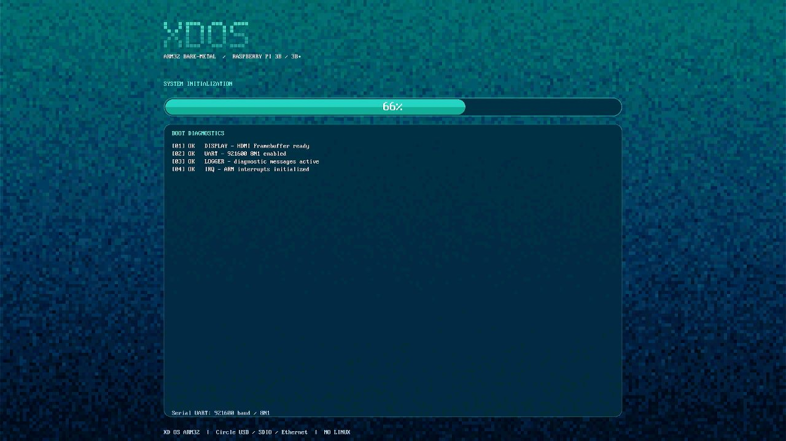
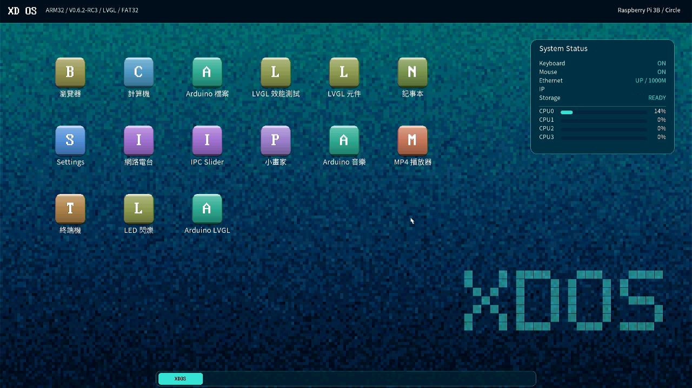

# Raspberry Pi XDOS

[English](README.md) · [繁體中文](README_ZH.md) · [FVR21 プレリリース](https://github.com/hypersolver/raspberry-pi-xdos/releases/tag/v0.6.2-rc3-xapp6-fvr21) · [基本版 XAPP6](https://github.com/hypersolver/raspberry-pi-xdos/releases/tag/v0.6.2-rc3-xapp6)

XDOS は Raspberry Pi 向けの ARM32 ベアメタルデスクトップです。Circle がデバイスを管理し、LVGL がアプリの画面を描画します。外部 XAPP は microSD から読み込みます。公開版の主な実機検証環境は Raspberry Pi 3B+ です。
[機種別の配線と書き込み手順](docs/flashing-by-board.md) · [ネットワーク・起動モード・言語の設定](docs/configuration.md) · [音楽・写真・動画の操作](docs/media-playback.md)

## XDOS の画面

新しいデスクトップには粒状のグラデーション、フローティングドック、コアごとの CPU 使用率を表示するステータスカードがあります。起動画面には進捗バーと各段階の診断結果を表示します。Raspberry Pi 3B+ 上の開発ビルドを HDMI で 1280×720 で撮影しました。LAN アドレスはマスク済みです。

| 起動診断 | デスクトップ |
| --- | --- |
|  |  |

右下の XDOS ロゴを明るくしたデザインは実機での確認待ちです。[ロゴのプレビュー](docs/ui/logo-preview.png)

[FVR19 起動画面](docs/fvr19/boot.png) · [FVR19 デスクトップ](docs/fvr19/desktop.png) · [FVR19 LVGL Benchmark](docs/fvr19/benchmark.png)

## インストールと開発

1. 配布ファイルの SHA-256 を確認します。
2. Pi の起動ファームウェアがある FAT 形式の microSD に IMG と対応する XAPP を配置します。config.txt の kernel= で IMG を指定して起動します。
3. Arduino スケッチは [RPiDuino](https://github.com/hypersolver/RPiDuino) の XDOS XAPP ターゲットでビルドし、起動済みの XDOS に配置します。

[アーキテクチャ・開発記録・書き込みフロー](docs/architecture.ja.md) · [操作ガイド（繁体字中国語）](source/v0.6.2-rc3-xapp6/OPERATIONS_ZH.md) · [バージョン一覧](VERSIONS.md)
