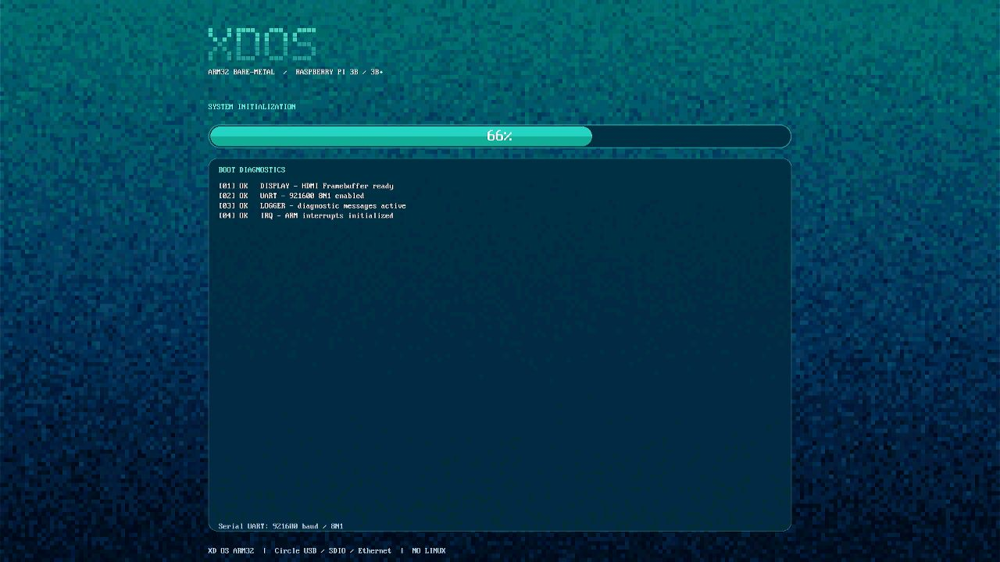
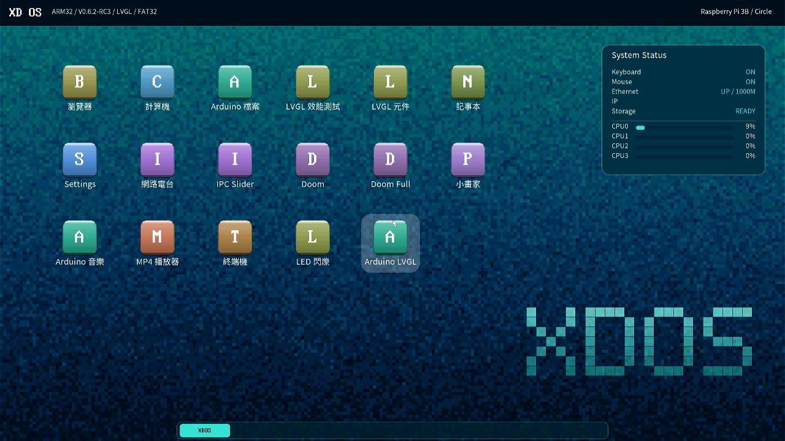

# Raspberry Pi XDOS

[English home](README.md) · [日本語](README_JA.md) · [FVR21 預發行版](https://github.com/hypersolver/raspberry-pi-xdos/releases/tag/v0.6.2-rc3-xapp6-fvr21) · [基礎版 RC3 XAPP6 Release](https://github.com/hypersolver/raspberry-pi-xdos/releases/tag/v0.6.2-rc3-xapp6)

XDOS 是將 XD OS 移植到 Raspberry Pi 的 ARM32 裸機桌面系統。以 Circle 提供硬體支援，使用 LVGL 繪製桌面，並從 microSD 載入外部 XAPP。近期版本以 Raspberry Pi 3B+ 為實機驗證平台，搭配 Windows WSL2 交叉編譯。
[各板型接線與燒錄路徑](docs/flashing-by-board.md) · [網路、系統模式與語系檔設定](docs/configuration.md) · [音樂、相片與影片操作](docs/media-playback.md)

## RPiDuino Arduino SDK

Arduino SDK、板卡套件與範例已移至 [RPiDuino](https://github.com/hypersolver/RPiDuino)。[Arduino IDE 安裝與操作](https://github.com/hypersolver/RPiDuino/blob/main/README.md) · [開發板管理員索引](https://raw.githubusercontent.com/hypersolver/RPiDuino/main/package_rpiduino_index.json) · [舊版 XDOS 索引](https://raw.githubusercontent.com/hypersolver/raspberry-pi-xdos/main/package_rpiduino_index.json)

## 快速開始

- [SDPRE 發行、安裝與回退說明](docs/sdpre.zh-TW.md)

- [MultiCore Media 發行、實測、操作與常見問題](docs/multicore-media.zh-TW.md)

- [MultiCore APPSCAN 發行、操作與常見問題](docs/multicore-appscan.zh-TW.md)

1. [從 microSD 建立 XDOS 並進入桌面](docs/xdos-quick-start.zh-TW.md)
2. [Arduino 草稿開發、XAPP 部署與執行](docs/arduino-xapp.zh-TW.md)
3. [XAPP 桌面捷徑與圖示規格](docs/xapp-desktop-spec.zh-TW.md)

## XDOS 介面

新版桌面採用顆粒漸層、浮動 Dock，以及顯示各核心使用率的系統狀態卡。開機畫面新增進度條與逐步診斷。下圖為 Raspberry Pi 3B+ 開發版本的 1280×720 HDMI 實機擷取，桌面的區網位址已遮蔽。

| 開機診斷 | 桌面 |
| --- | --- |
|  |  |

桌面實拍來自 Raspberry Pi 3B+ 執行的 FVDOOMD，右下角 XDOS 字樣已採用上方提亮的青綠漸層。

[FVR19 開機畫面](docs/fvr19/boot.png) · [FVR19 桌面](docs/fvr19/desktop.png) · [FVR19 LVGL Benchmark](docs/fvr19/benchmark.png)

## 開發動機與架構

[最新研發紀錄、多 CPU、開機模式、Arduino 與燒錄流程圖](docs/architecture.zh-TW.md)

專案從移植 XD OS 開始，探索如何用小型裸機核心提供互動桌面，並讓應用程式可以分開開發與替換。Pi 開機韌體載入 XDOS 核心，由 Circle 提供 SD、USB、網路和 UART，LVGL 負責桌面，XAPP Loader 透過 ARM32 API 啟動外部應用。顯示使用 VC4 EGL VSync，保留 framebuffer 回退。[系統架構圖](README.md#system-architecture)

建立版本時，在 WSL2 使用固定的依賴版本交叉編譯，產出核心 IMG、配對 XAPP 和 SHA-256。經區網傳到 Pi 3B+ 後，從 UART 確認開機並驗證顯示、輸入及回退，再更新 GitHub main 和 Release。[開發與部署架構圖](README.md#development-and-deployment)

未來可用於嵌入式狀態面板、離線工具桌面和裸機系統教學或測試。選配媒體服務和裝置驅動仍屬開發方向，驗證狀態見研發紀錄。

**目前的預發行版是 Pixel BBS Layout。** Pi 3B+ 已在 720p 和 1080p 驗證自適應圖示、文字、間距及九個捷徑。Release 提供核心 IMG、配對 XAPP、原始碼快照與 SHA-256。 [下載 PXLAYOUT](https://github.com/hypersolver/raspberry-pi-xdos/releases/tag/v0.6.2-rc3-xapp6-pxlayout)

## 開始使用

[MultiCore Pi 3B+ 效能預發行版](https://github.com/hypersolver/raspberry-pi-xdos/releases/tag/v0.6.2-rc3-xapp6-multicore) 提供四核 LVGL 繪圖，套件實測紀錄的 1080p 官方 Benchmark 平均由 17 提升至 46 FPS。安裝時請搭配此版 XAPP。[功能、安裝與實測](source/v0.6.2-rc3-xapp6/MULTICORE_ZH.md)

| 需求 | 文件 |
| --- | --- |
| PXLAYOUT 實測、microSD 安裝、部署、播放器及回退 | [Pixel BBS Layout 指南](source/v0.6.2-rc3-xapp6/PXLAYOUT_ZH.md) |
| 核心 ABI、XAPP API 與使用範例 | [XAPP API 與開發指南](source/v0.6.2-rc3-xapp6/XAPP_API_ZH.md) |
| 近期實測、媒體實驗及限制 | [研發與驗證紀錄](source/v0.6.2-rc3-xapp6/DEVELOPMENT_ZH.md) |
| IMG、靜態 RAM、XAPP 保留區及優化優先順序 | [核心區段盤點](source/v0.6.2-rc3-xapp6/CORE_SECTIONS_ZH.md) |
| WSL2 建置、首次安裝到 microSD、桌面操作 | [XDOS 安裝與操作指南](source/v0.6.2-rc3-xapp6/OPERATIONS_ZH.md) |
| 使用 Terminal、查詢效能、從 UART 啟動 XAPP | [Terminal Window 操作說明](source/v0.6.2-rc3-xapp6/TERMINAL_ZH.md) |
| UART 指令、協定與新增指令 | [UART 指令參考](source/v0.6.2-rc3-xapp6/UART_ZH.md) |
| 區網傳檔、選擇開機映像、RESET 與回退 | [區網部署指南](source/v0.6.2-rc3-xapp6/NETWORK_UPDATE_ZH.md) |

首次安裝時，將 IMG 複製到已有 Raspberry Pi 開機韌體的 FAT 開機分割區，設定 `config.txt` 的 `kernel=`，並安裝同一 Release 的 XAPP。這裡的 IMG 是裸機核心檔。完整步驟與回退方式見上表。

## 研發紀錄

| 階段 | 里程碑 |
| --- | --- |
| V0.1–V0.3 · ARM32 移植 | V0.1 顯示靜態 HDMI framebuffer 桌面。V0.2 驗證 USB 鍵鼠與視窗操作。V0.3 加入 RAM back buffer、局部重畫、有線網路與 HTTP Browser。當時使用者回報從開機畫面到桌面約 3 秒。 |
| V0.4–V0.5.4 · 網路與儲存 | 開發 Wi-Fi 和 HTTP 逾時，加入開機 Splash、Ethernet／Wi-Fi 選擇、優先顯示桌面與 FAT32。V0.5、V0.5.2 已從舊 Pi 4 找回原始碼與核心。V0.4 有明確標示的重建版，尚未實機開機。V0.5.1 尚無可驗證原檔。 |
| V0.6.1–RC3 XAPP6 · LVGL 與外部程式 | 整合 LVGL 局部重畫。官方 Widgets 與 Benchmark 改由外部 XAPP 載入，執行區在開機時保留於 RAM。 |
| RegionGuard · VideoCore IV | VC4 GLES2 呈現搭配 EGL VSync，保留 VSyncOpt 回退。捲動快取遇到重繪區和快取重疊時採用保守重畫，避免漏圖和殘影。 |
| AppWindows、BrowserText、Wired · 核心精簡 | 桌面工具改成視窗版 XAPP，補齊文字鍵，將 Browser HTTP 和 HTML 轉文字移到 XAPP。核心保留區網更新，有線版移除內建 Wi-Fi。 |
| HDMI Auto · 解析度與顯示 | 讓 framebuffer、XDOS、LVGL 和 VC4 使用同一尺寸。720p 桌面已驗證。1080p 的官方 Benchmark 圖形上捲修正版已確認無殘影，EGL VSync 保持啟用。 |
| Terminal Window · 共用指令 | Terminal 可用桌面捷徑或 UART 啟動，沿用視窗縮放動畫和 CPU 顯示。Terminal 與 UART 共用核心指令表。 |
| Pixel BBS Layout · 自適應桌面 | 開機進度條和桌面共用 8×8 顆粒主題。Pi 3B+ 的 720p 與 1080p 各完成九個圖示及九個名稱的滑鼠啟動測試。 |

版本細節、歷史檔案與驗證狀態見 [版本總覽](VERSIONS.md)、[早期版本復原紀錄](archive/PI4_RECOVERY_ZH.md) 和 [HDMI Auto 實測說明](source/v0.6.2-rc3-xapp6/HDMI_AUTO_ZH.md)。早期 V0.1–V0.3 建置與開機方式見 [歷史操作手冊](OPERATIONS.md)。

原始碼與文件維護於 `main`，各版以 Git 標籤和 Releases 查找。[發布流程](RELEASING.md) · [授權及第三方元件](LICENSE.md)

**MC4FQ（Pi 3B+）** · 最多同時執行四個 V2 XAPP · [Release 與 FILEQ128 升級說明](https://github.com/hypersolver/raspberry-pi-xdos/releases/tag/v0.6.2-rc3-xapp6-mc4fq)

**FILEQ128 預覽版與 RPiDuino 0.1.4** · [安裝、更新與研發紀錄](docs/fileq128.zh-TW.md) · [Release](https://github.com/hypersolver/raspberry-pi-xdos/releases/tag/v0.6.2-rc3-xapp6-fileq128)

[原始碼與授權清冊](SOURCE_MANIFEST.md)
