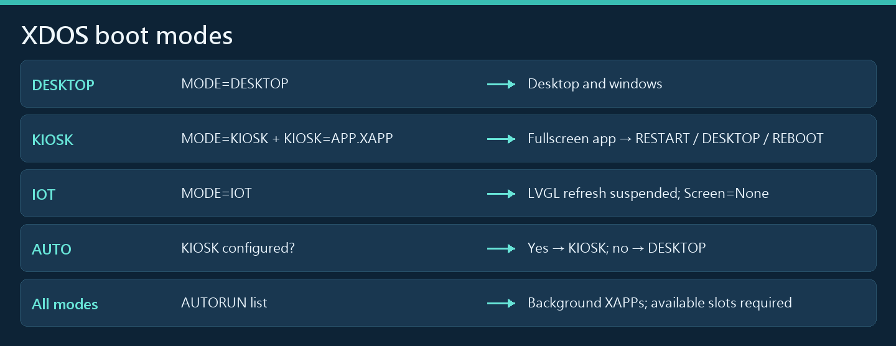
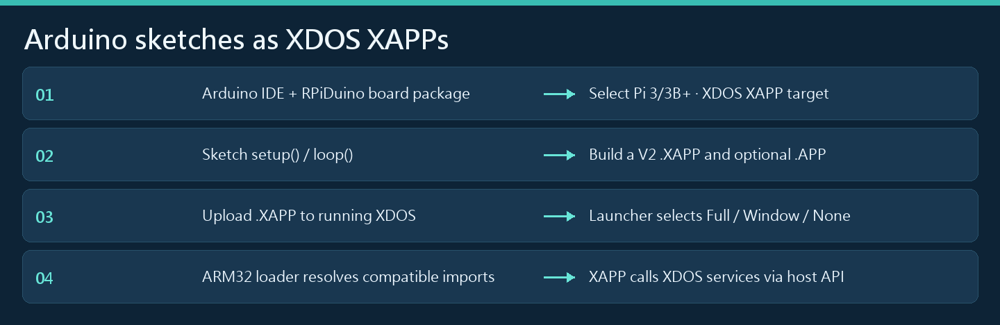
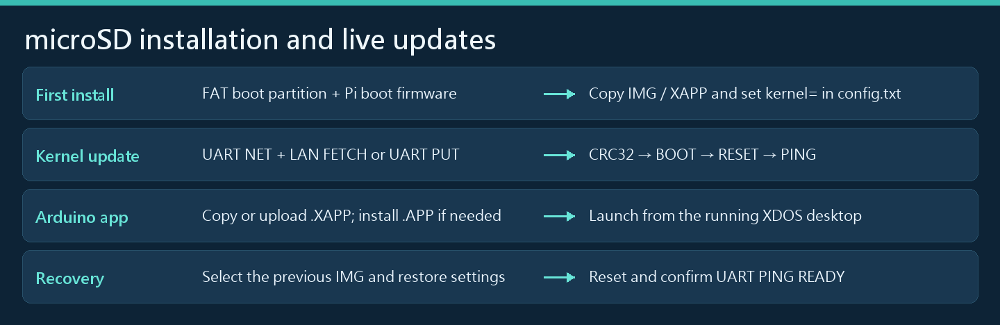
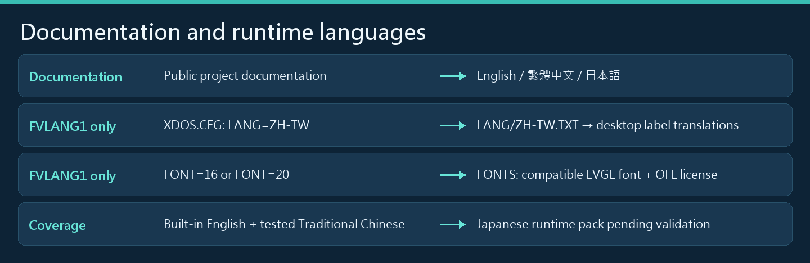

# XDOS アーキテクチャと開発記録

[English](architecture.md) · [繁體中文](architecture.zh-TW.md) · [バージョン一覧](../VERSIONS.md)

## 公開版の実機検証

| 版 | 確認した内容 |
| --- | --- |
| FVR17 | 互換カーネル間で V2 のインポートを解決。同名・同内容の再送信は成功し、内容が異なる場合は拒否。 |
| FVR18 | Pi 3B+ で 4 コアの使用率と実行中の XAPP 名を確認。 |
| FVR19 | 起動モード、AUTORUN、KIOSK の終了処理、ロールバックを UART で確認。44 項目が合格。 |
| FVR20 | ホストの 921600 baud、400 MHz 固定クロック、UART・有線 LAN 転送の CRC32、長いディレクトリ一覧を確認。 |
| FVR21 | 読み取り専用 UART NET で IP、マスク、ゲートウェイ、アドレス設定方式を表示。DHCP とホスト側のインターフェース選択を確認。固定 IP とケーブル切断の実機検証は未実施。 |

FVR19 の 1080p LVGL ベンチマークでは全体が 41 FPS、スクロールするコンテナーが 43 FPS。全画面テキストとオーバーレイは今後の最適化対象。部分再描画、フォント、画像デコード、追加の V2 移行は試験ビルドで開発中です。

## アーキテクチャと書き込み手順

CPU0 はデバイス I/O と UI のイベントループを担当します。CPU1～CPU3 は LVGL の描画や対応 XAPP の計算処理に使われます。共有 CPU0 経路を含め、V2 は最大 4 スロットを同時に使用できます。UI とデバイスへのアクセスはホスト API の実行コア制約に従います。

公開ドキュメントは英語、繁体字中国語、日本語で提供します。試験ビルドでは繁体字の LVGL フォントをライセンス付きで microSD から読み込みます。FVLANG1 では microSD の言語辞書でデスクトップのラベルを翻訳する機能も試験中です。日本語の実行時言語パックは実機未検証です。

FVR21 の AUTO は KIOSK の設定を参照します。HDMI 接続状態による切り替えはありません。AUTORUN は各モードでバックグラウンド XAPP を起動します。IOT は LVGL の更新を停止し、Screen=None のみ受け入れます。KIOSK は全画面 XAPP を起動し、終了時に指定された動作を実行します。

Arduino では [RPiDuino SDK](https://github.com/hypersolver/RPiDuino) の Pi 3/3B+ XDOS XAPP ターゲットを使います。初回は Pi ファームウェアのある FAT 起動パーティションに IMG をコピーし、以降は既存の XDOS へ XAPP を配置できます。[操作ガイド（繁体字中国語）](../source/v0.6.2-rc3-xapp6/OPERATIONS_ZH.md)

### システム構成

### マルチコアの実行構成

### デスクトップ・KIOSK・IOT

### Arduino XAPP の構成

### microSD への書き込みと更新

### ドキュメントの言語と実行時フォント

Pi 3B+ の繁体字デスクトップ（FVLANG1 試験版、LAN アドレスはマスク済み）

### 開発とリリースの流れ

