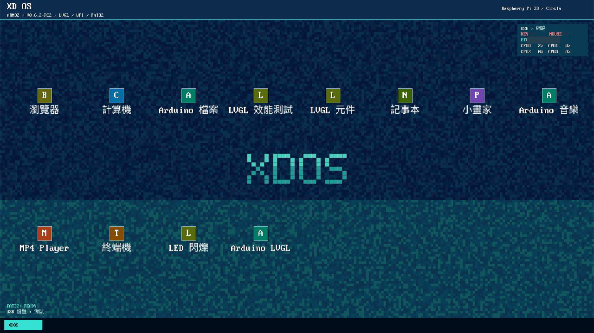

# XDOS アーキテクチャと開発記録

[English](architecture.md) · [繁體中文](architecture.zh-TW.md) · [バージョン一覧](../VERSIONS.md)

## 公開版の実機検証

| 版 | 確認した内容 |
| --- | --- |
| FVR17 | 互換カーネル間で V2 のインポートを解決。同名・同内容の再送信は成功し、内容が異なる場合は拒否。 |
| FVR18 | Pi 3B+ で 4 コアの使用率と実行中の XAPP 名を確認。 |
| FVR19 | 起動モード、AUTORUN、KIOSK の終了処理、ロールバックを UART で確認。44 項目が合格。 |
| FVR20 | ホストの 921600 baud、400 MHz 固定クロック、UART・有線 LAN 転送の CRC32、長いディレクトリ一覧を確認。 |
| FVR21 | 読み取り専用 UART NET で IP、マスク、ゲートウェイ、アドレス設定方式を表示。DHCP とホスト側のインターフェース選択を確認。固定 IP とケーブル切断の実機検証は未実施。 |

FVR19 の 1080p LVGL ベンチマークでは全体が 41 FPS、スクロールするコンテナーが 43 FPS。全画面テキストとオーバーレイは今後の最適化対象。部分再描画、フォント、画像デコード、追加の V2 移行は試験ビルドで開発中です。

## アーキテクチャと書き込み手順

CPU0 はデバイス I/O と UI のイベントループを担当します。CPU1～CPU3 は LVGL の描画や対応 XAPP の計算処理に使われます。共有 CPU0 経路を含め、V2 は最大 4 スロットを同時に使用できます。UI とデバイスへのアクセスはホスト API の実行コア制約に従います。

公開ドキュメントは英語、繁体字中国語、日本語で提供します。試験ビルドでは繁体字の LVGL フォントをライセンス付きで microSD から読み込みます。FVLANG1 では microSD の言語辞書でデスクトップのラベルを翻訳する機能も試験中です。日本語の実行時言語パックは実機未検証です。

FVR21 の AUTO は KIOSK の設定を参照します。HDMI 接続状態による切り替えはありません。AUTORUN は各モードでバックグラウンド XAPP を起動します。IOT は LVGL の更新を停止し、Screen=None のみ受け入れます。KIOSK は全画面 XAPP を起動し、終了時に指定された動作を実行します。

Arduino では [RPiDuino SDK](https://github.com/hypersolver/RPiDuino) の Pi 3/3B+ XDOS XAPP ターゲットを使います。初回は Pi ファームウェアのある FAT 起動パーティションに IMG をコピーし、以降は既存の XDOS へ XAPP を配置できます。[操作ガイド（繁体字中国語）](../source/v0.6.2-rc3-xapp6/OPERATIONS_ZH.md)

### システム構成

~~~mermaid
flowchart TD
    FW["Pi firmware + config.txt"] --> IMG["XDOS ARM32 IMG"]
    IMG --> C["Circle: FAT32 / USB / Ethernet / UART"]
    IMG --> D["XDOS desktop + LVGL"]
    D --> VC["VC4 GLES2 / EGL VSync"]
    D --> FB["VSyncOpt / framebuffer"]
    IMG --> V2["XAPP V2 loader"]
    V2 --> APPS["microSD: .APP + .XAPP"]
~~~

### マルチコアの実行構成

~~~mermaid
flowchart LR
    CPU0["CPU0: UI / IRQ / I/O / scheduler"] --> DRAW["LVGL draw work"]
    DRAW --> C1["CPU1"]
    DRAW --> C2["CPU2"]
    DRAW --> C3["CPU3"]
    C1 -. "lend when available" .-> APP["XAPP compute"]
    C2 -.-> APP
    C3 -.-> APP
    APP -->|request| CPU0
~~~

### デスクトップ・KIOSK・IOT

~~~mermaid
flowchart TD
    CFG["XDOS/XDOS.CFG or INBOX fallback"] --> MODE{"MODE"}
    MODE -->|DESKTOP| D["Desktop"]
    MODE -->|KIOSK| K["KIOSK= .XAPP / Full"]
    MODE -->|IOT| I["Background / Screen=None"]
    MODE -->|AUTO| A{"KIOSK set?"}
    A -->|Yes| K
    A -->|No| D
    K --> EXIT{"KIOSK_EXIT"}
    EXIT -->|RESTART| K
    EXIT -->|DESKTOP| D
    EXIT -->|REBOOT| CFG
~~~

### Arduino XAPP の構成

~~~mermaid
flowchart LR
    IDE["Arduino IDE + RPiDuino"] --> SK["Sketch: setup / loop"]
    SK --> BUILD["Pi 3/3B+ · XDOS XAPP"]
    BUILD --> FILE["V2 .XAPP + optional .APP"]
    FILE --> LOAD["XDOS loader / ARM32 imports"]
    LOAD --> SCREEN["Screen=Full / Window / None"]
    LOAD --> SERVICE["XDOS API / CPU0 services"]
~~~

### microSD への書き込みと更新

~~~mermaid
flowchart TD
    PKG["Release files + SHA-256"] --> PLAN{"Install or update?"}
    PLAN -->|First install| SD["FAT boot partition + Pi firmware"]
    SD --> COPY["Copy IMG / XAPP; set kernel= in config.txt"]
    PLAN -->|Kernel update| NET["UART NET → LAN transfer or UART PUT"]
    NET --> CHECK["CRC32 → BOOT → RESET"]
    COPY --> RUN["Pi 3B+: boot + PING READY"]
    CHECK --> RUN
    PLAN -->|Arduino XAPP only| APP["Copy or upload .XAPP; install .APP if needed"]
    APP --> TEST["Launch from XDOS"]
    RUN -->|Failure| RB["Restore previous kernel and config"]
~~~

### ドキュメントの言語と実行時フォント

~~~mermaid
flowchart LR
    DOC["Public documentation"] --> EN["English"]
    DOC --> TC["繁體中文"]
    DOC --> JP["日本語"]
    SD["microSD / FONTS"] -. "experimental" .-> FONT["LVGL Traditional Chinese fallback"]
    FONT -.-> UI["LVGL XAPP text and FVLANG1 labels"]
~~~

Pi 3B+ の繁体字デスクトップ（FVLANG1 試験版、LAN アドレスはマスク済み）

### 開発とリリースの流れ

~~~mermaid
flowchart LR
    SRC["Git source + dependency revisions"] --> BUILD["WSL cross-build"]
    BUILD --> ART["IMG / XAPP / SHA-256"]
    ART --> HW["Pi 3B+ / UART / HDMI"]
    HW -->|Pass| PUB["GitHub main + Release"]
    HW -->|Fail| RB["Rollback and investigate"]
~~~
