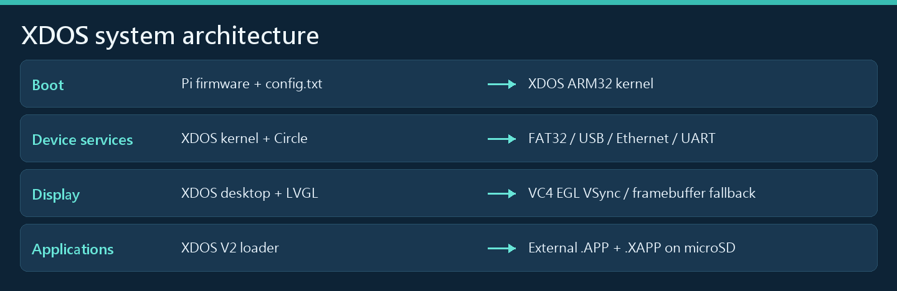
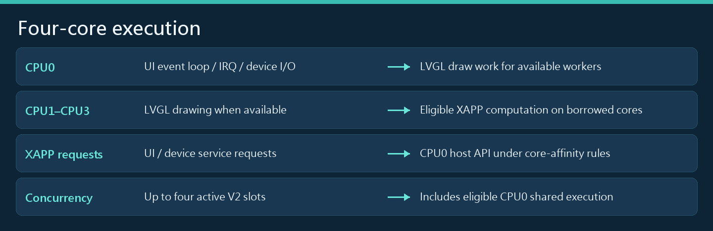
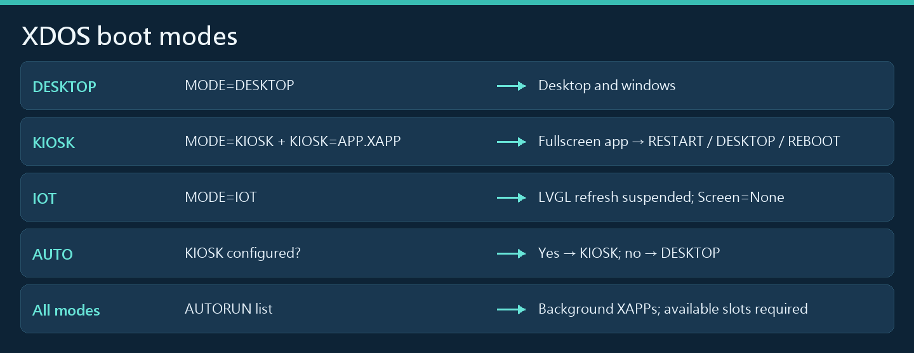
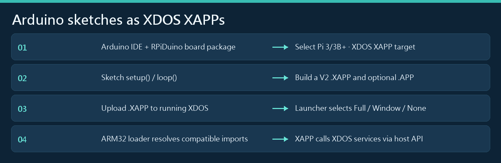
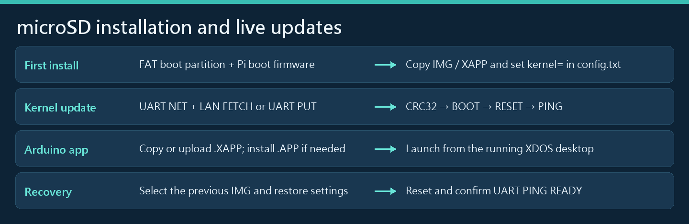
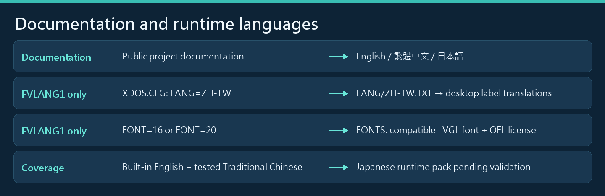
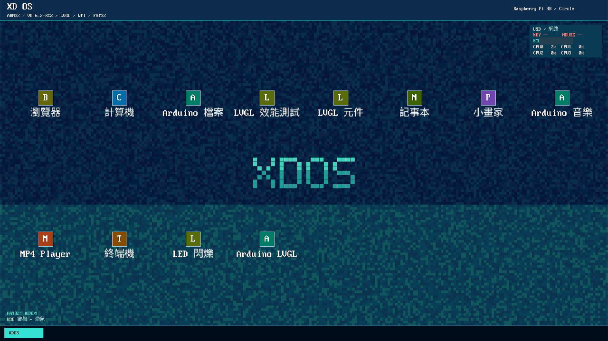
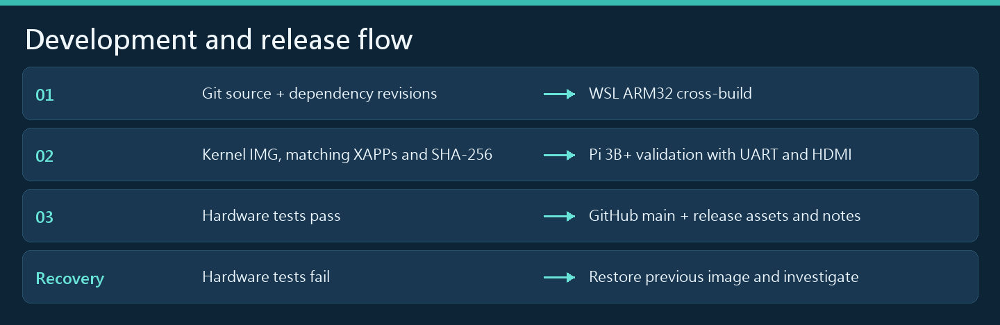

# XDOS architecture and development record

[繁體中文](architecture.zh-TW.md) · [日本語](architecture.ja.md) · [Version index](../VERSIONS.md)

## Published milestones and experimental work

| Milestone | What was verified |
| --- | --- |
| FVR17 | External V2 imports bind across compatible kernels. Identical uploads succeed and conflicting contents under the same name are rejected. |
| FVR18 | Four CPU utilization values and active XAPP names were checked on Pi 3B+. |
| FVR19 | 44 UART checks passed for boot modes, AUTORUN, Kiosk exit and rollback. |
| FVR20 | Host 921600 baud, 400 MHz mini UART clock, UART and Ethernet CRC32, and long directory listings passed. |
| FVR21 | Read-only UART NET reports live IPv4, mask, gateway and address mode. DHCP and host interface selection passed. Static and disconnected cases were not tested on hardware. |

The FVR19 1080p LVGL baseline measured 41 FPS overall and 43 FPS for scrolling containers. Full-screen text and container overlays remain optimization targets. Experimental work on sparse redraw, font assets, image decoding and broader V2 migration has separate test builds. These changes are pending individual integration into published releases.

## Architecture and deployment diagrams

CPU0 owns hardware I/O and the UI event loop. CPUs 1–3 can process LVGL drawing or be lent to eligible XAPP compute jobs. Up to four V2 slots may be active, with a shared CPU0 path when eligible. Device and UI service calls must follow the host API and its core-affinity rules.

The public documentation is available in English, Traditional Chinese and Japanese. The test builds load Traditional Chinese LVGL font assets from microSD with separate license files. FVLANG1 additionally prototypes SD-based language dictionaries for desktop labels. The Japanese guide describes the current system. A Japanese runtime pack has not been validated.

On FVR21, AUTO follows the KIOSK setting without HDMI detection. AUTORUN launches background XAPPs across modes. IOT suspends LVGL refresh and accepts Screen=None. Kiosk runs one fullscreen XAPP and applies the chosen exit policy.

For Arduino development, use the [RPiDuino SDK](https://github.com/hypersolver/RPiDuino). Select the Pi 3/3B+ XDOS XAPP target and deploy the compiled module to an existing XDOS installation. The kernel IMG is the bare-metal executable copied onto the FAT boot partition alongside Pi firmware. Use the [operations guide](../source/v0.6.2-rc3-xapp6/OPERATIONS_ZH.md) for SD preparation and rollback.

### System overview

### Multicore scheduling

### Desktop, Kiosk and IOT modes

### Arduino XAPP architecture

### microSD installation and updates

### Documentation languages and runtime fonts

Traditional Chinese desktop on Pi 3B+ (FVLANG1 test build; LAN address masked)

### Development and release flow

