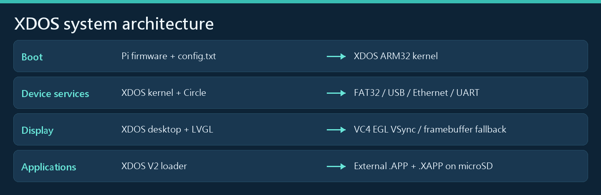
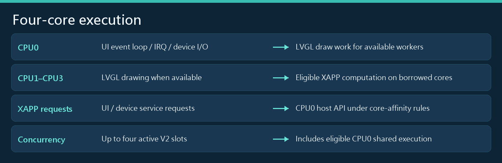
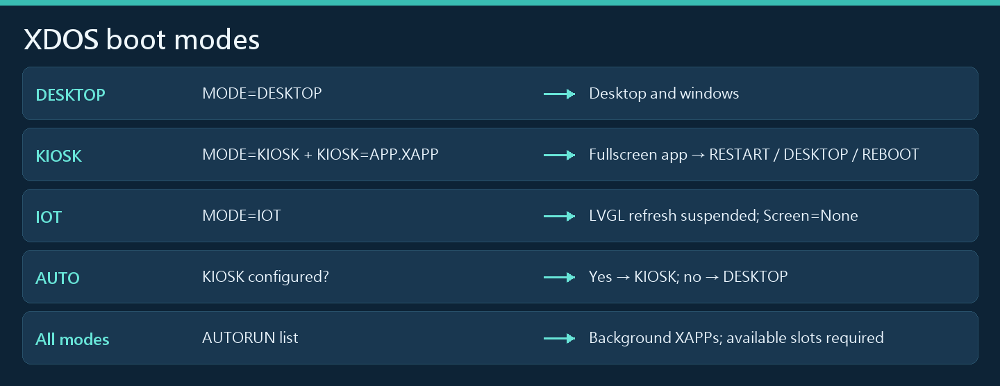
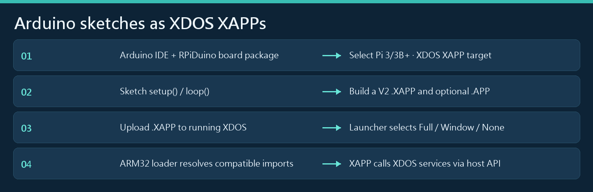
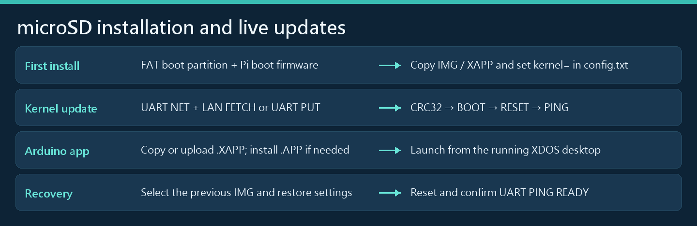
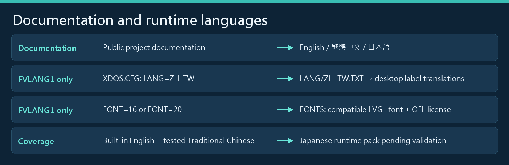
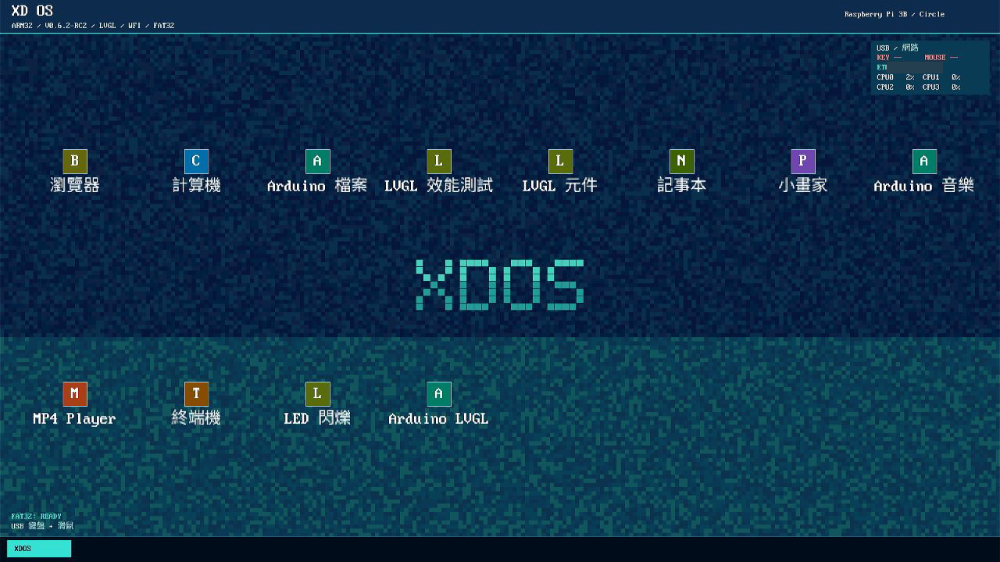
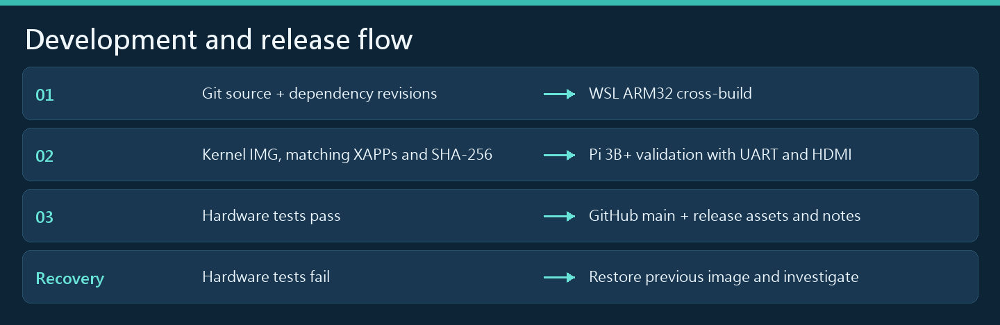

# XDOS 架構與研發紀錄

[English](architecture.md) · [日本語](architecture.ja.md) · [版本總覽](../VERSIONS.md)

## 已發布版本與實驗進度

| 版本 | 實測紀錄 |
| --- | --- |
| FVR17 | V2 模組可跨相容核心綁定匯入符號，同名同內容可重複上傳，同名異檔會被拒絕。 |
| FVR18 | Pi 3B+ 驗證四核心使用率與執行中的 XAPP 名稱。 |
| FVR19 | 開機模式、AUTORUN、KIOSK 退出及回退共 44 項 UART 檢查通過。 |
| FVR20 | 921600 baud、400 MHz 固定時脈、UART／有線網路 CRC32 與長目錄清單通過。 |
| FVR21 | 唯讀 UART NET 可查即時 IPv4、遮罩、閘道與取址模式。DHCP 與主機網卡選擇已驗證，靜態 IP 和拔線未上機驗證。 |

FVR19 的 1080p LVGL 基線為整體 41 FPS、捲動容器 43 FPS。滿版文字和容器疊層仍待優化。局部重繪、字型、圖片解碼及其他 V2 移植已有實驗建置，依各項驗證結果個別整合與發行。

## 架構與燒錄流程圖

CPU0 負責硬體 I/O 和 UI 事件迴圈。CPU1–CPU3 可繪製 LVGL，或借給符合條件的 XAPP 運算。V2 最多可同時啟用四槽，其中可用 CPU0 的共享模式。UI 與裝置服務依核心的 API 與執行核心限制使用。

公開文件提供英語、繁體中文和日語。測試版的 LVGL 繁體中文字型從 microSD 載入並附授權；FVLANG1 另有實驗桌面語系功能，可從 microSD 載入字典並翻譯圖示名稱。日文文件已提供，日文執行時語系包尚未實機驗證。

FVR21 的 AUTO 依 KIOSK 欄位選擇模式，不讀取 HDMI 狀態。各模式皆可用 AUTORUN 啟動背景 XAPP。IOT 暫停 LVGL 更新並限制 Screen=None。KIOSK 啟動一個全螢幕 XAPP，結束時依設定處理。

Arduino 請使用 [RPiDuino SDK](https://github.com/hypersolver/RPiDuino)，選 Pi 3/3B+ 的 XDOS XAPP 模式。首次安裝將 IMG 複製到已有 Pi 韌體的 FAT 開機分割區；後續 Arduino 草稿編成 XAPP，部署到既有 XDOS。完整步驟見[操作指南](../source/v0.6.2-rc3-xapp6/OPERATIONS_ZH.md)。

### 系統總覽

### 多 CPU 排程

### 桌面、KIOSK 與 IOT 模式

### Arduino XAPP 架構

### microSD 燒錄與更新

### 文件語系與執行時字型

Pi 3B+ 繁體中文桌面（FVLANG1 測試版，區網位址已遮蔽）

### 開發與發布流程

