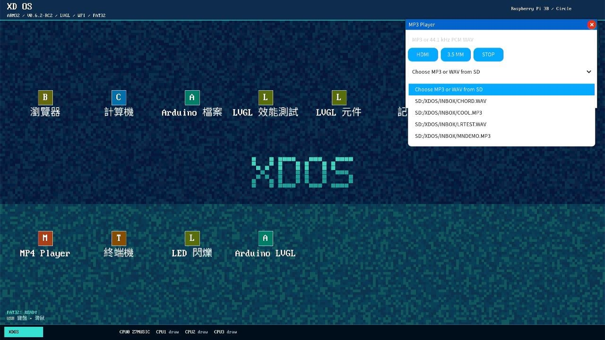
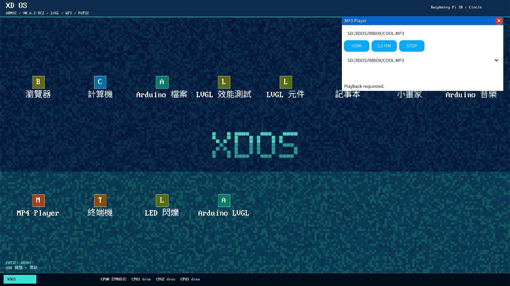
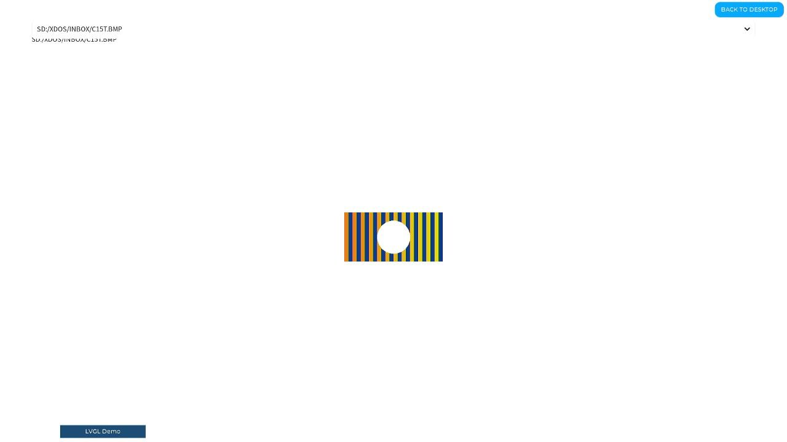
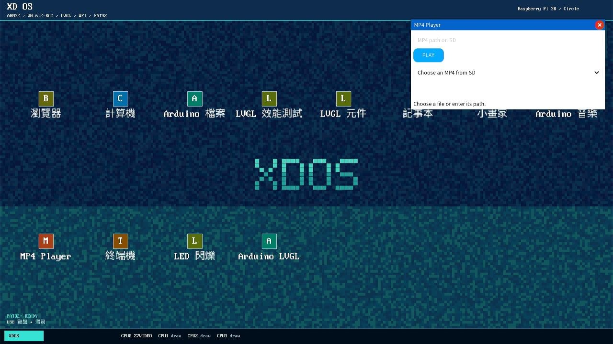

# XDOS media playback · 影音操作 · メディア再生

[English](#english) · [繁體中文](#繁體中文) · [日本語](#日本語)

## English

- **Music.** Copy MP3 or compatible PCM WAV to `XDOS/MUSIC/` or `XDOS/INBOX/`. Open **Arduino MP3** or **MP3 Player** on the desktop, select a file, and choose **HDMI** or **3.5 MM**. Press **STOP** to end playback. Start with HDMI when checking audio output.
- **Photos.** In the FVLANG1 test build, open **Image View**, or use **Arduino Files** to double-click the supplied Image View module. Select a test BMP from the dropdown. The screen below shows a BMP loaded from INBOX. **BACK TO DESKTOP** exits the viewer.
- **Video.** Copy an H.264 MP4 to `XDOS/VIDEO/` or `XDOS/INBOX/`. Open **MP4 Player**, select the file and press **PLAY**. For a UART example use `@XDOS PLAY DEMO.MP4` with the file in INBOX. This player handles the video track. Start with a tested 720p clip when troubleshooting. 1080p decoding remains experimental.

## 繁體中文

- **音樂。** 把 MP3 或相容的 PCM WAV 放到 `XDOS/MUSIC/` 或 `XDOS/INBOX/`。開啟桌面 **Arduino MP3** 或 **MP3 Player**，選檔後按 **HDMI** 或 **3.5 MM**。按 **STOP** 停止播放。排查無聲時可先測 HDMI。
- **相片。** 在 FVLANG1 測試版開啟 **Image View**，也可用 **Arduino 檔案**雙擊對應的 Image View 模組。從下拉選單選擇 BMP。下圖為從 INBOX 讀到的測試圖，按 **BACK TO DESKTOP** 離開。
- **影片。** 把 H.264 MP4 放到 `XDOS/VIDEO/` 或 `XDOS/INBOX/`。開啟 **MP4 Player**，選檔後按 **PLAY**。若檔案在 INBOX，可用 UART `@XDOS PLAY DEMO.MP4`。此播放器處理視訊軌。遇到播放問題時先用已驗證的 720p 測試檔。1080p 解碼仍屬實驗。

## 日本語

- **音楽。** MP3 または対応する PCM WAV を `XDOS/MUSIC/` または `XDOS/INBOX/` に配置します。**Arduino MP3** または **MP3 Player** でファイルを選び、**HDMI** または **3.5 MM** を押します。**STOP** で停止します。音が出ない場合は HDMI から確認します。
- **写真。** FVLANG1 試験版の **Image View** を開くか、**Arduino Files** で対応するモジュールをダブルクリックします。ドロップダウンで BMP を選択します。下の写真は INBOX のテスト画像です。**BACK TO DESKTOP** で終了します。
- **動画。** H.264 MP4 を `XDOS/VIDEO/` または `XDOS/INBOX/` に配置します。**MP4 Player** でファイルを選び、**PLAY** を押します。INBOX のファイルは UART の `@XDOS PLAY DEMO.MP4` でも再生できます。このプレーヤーは映像トラックを再生します。まず検証済みの 720p 動画を使ってください。1080p デコードは試験段階です。

## Pi 3B+ HDMI capture · 實機擷取 · 実機キャプチャ

MP3 Player file selection · 音樂選檔 · 音楽ファイルの選択

MP3 playback requested · 已送出播放要求 · 再生要求を送信

Image View in FVLANG1 · FVLANG1 相片檢視 · FVLANG1 の画像表示

MP4 Player controls · 影片播放器操作介面 · 動画プレーヤーの操作画面

[Media release and compatibility](multicore-media.md) · [Installation and wiring](flashing-by-board.md)
