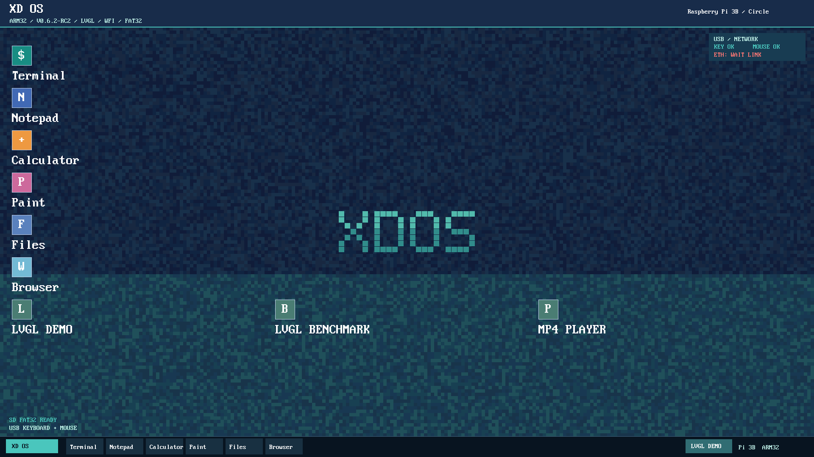

# 第 1 篇 · 從 microSD 啟動 XDOS

本篇使用已在 Raspberry Pi 3B+ 實測的 PXLAYOUT。準備 microSD、讀卡機、HDMI 螢幕、USB 鍵鼠和電源。已有 XDOS 卡時，可以用另一張卡做首次安裝，保留原版供回退。

## 準備 microSD

1. 下載 [RC3 XAPP6 基準包](../source/v0.6.2-rc3-xapp6/packages/XDOS_RC3_XAPP6_PI3_TEST.zip) 和 [PXLAYOUT Release](https://github.com/hypersolver/raspberry-pi-xdos/releases/tag/v0.6.2-rc3-xapp6-pxlayout)。依各自的 SHA-256 清單核對下載檔案。
2. 準備有 Pi 3B+ 韌體的 FAT32 開機分割區。若卡片是空白的，可先用 Raspberry Pi Imager 寫入適用 Pi 3B+ 的 Raspberry Pi OS，以取得開機韌體。Imager 會清除所選媒體，請先確認磁碟和備份。
3. 掛載 FAT32 開機分割區。從基準包複製 `XDOS/` 目錄，保留其 `APPS/` 和版本提供的其他子目錄。將 `PXLAYOUT.IMG` 複製到開機分割區根目錄。這個 IMG 是單一核心檔，使用檔案總管複製即可。
4. 在卡上建立 `XDOS/INBOX/`，將 PXLAYOUT Release 的 `PLAYER.XAPP`、`Q9WIDGET.XAPP`、`Q9BENCH.XAPP`、`Q9BROWSE.XAPP`、`Q9TERM.XAPP` 按原名複製進去。
5. 備份原本的 `config.txt`。依下例設定開機核心，保留需要的韌體設定，確保 Pi 3B+ 只會套用一個 `kernel=`。若是從 Raspberry Pi OS 卡改建，依版本安裝說明停用 `dtoverlay=vc4-kms-v3d`，讓 XDOS 使用韌體 framebuffer。

   ```ini
   [all]
   arm_64bit=0
   kernel=PXLAYOUT.IMG
   enable_uart=1
   ```

   [PXLAYOUT 安裝與回退細節](../source/v0.6.2-rc3-xapp6/PXLAYOUT_ZH.md) · [基準包 SHA-256](../source/v0.6.2-rc3-xapp6/packages/SHA256SUMS.txt)

## 進入 XDOS GUI

1. 安全退出 microSD。Pi 關機時插卡，接好 HDMI 和 USB 鍵鼠後再通電。
2. 確認先出現開機畫面與進度條，再進入 XDOS 桌面。點擊捷徑的圖示或名稱即可開啟應用。
3. 點 **Terminal**，輸入 `HELP` 檢查命令輸出，再按 **X** 關閉視窗。點 **LVGL Demo** 啟動 Widgets，測完按 **BACK TO DESKTOP**。
4. 如果沒有桌面，關電後確認 FAT32 開機分割區、核心檔名與 `config.txt`。若能連 Debug UART，PXLAYOUT 使用 **921600 baud、8N1**，可用 `PING` 及開機訊息判斷是否已啟動。 [UART 接線與命令](../source/v0.6.2-rc3-xapp6/UART_ZH.md)



完成基本安裝後，參閱[第 2 篇 · Arduino 草稿開發、部署與執行](arduino-xapp.zh-TW.md)。
